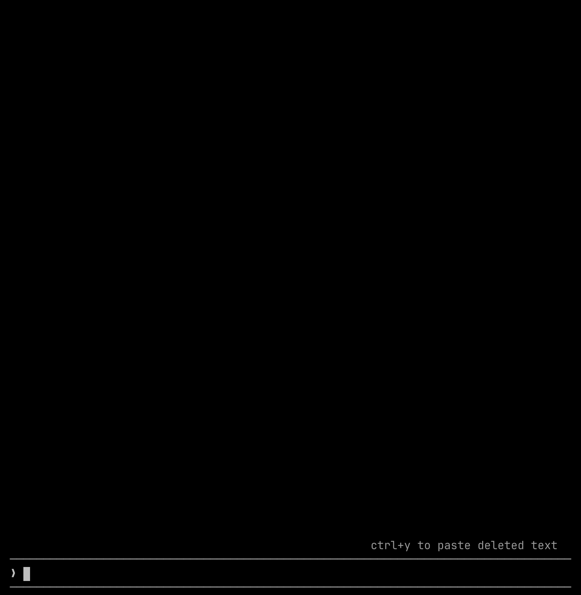
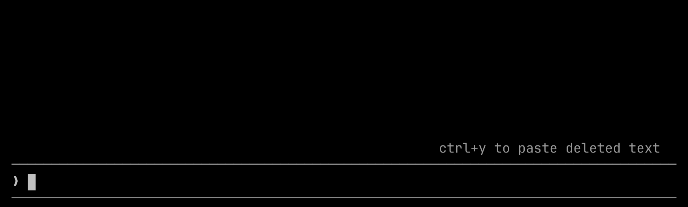
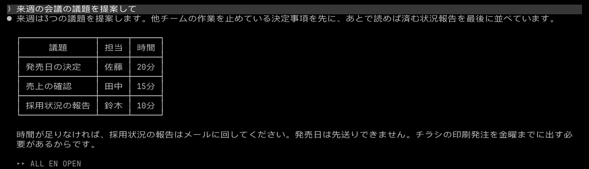
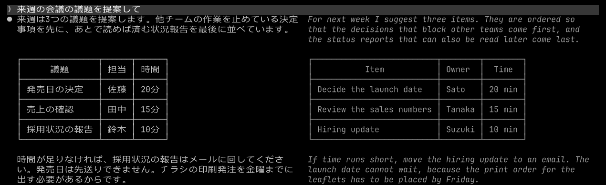
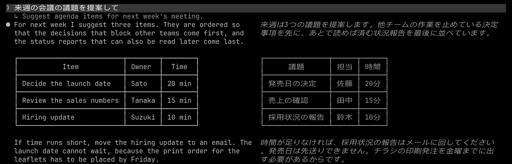
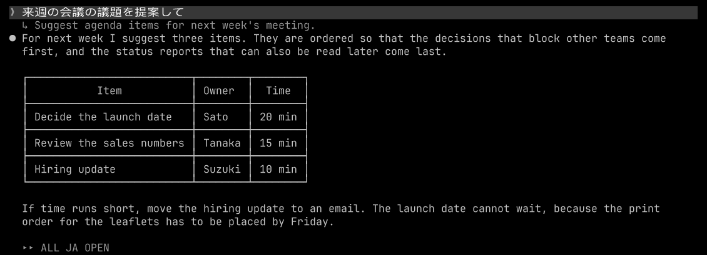
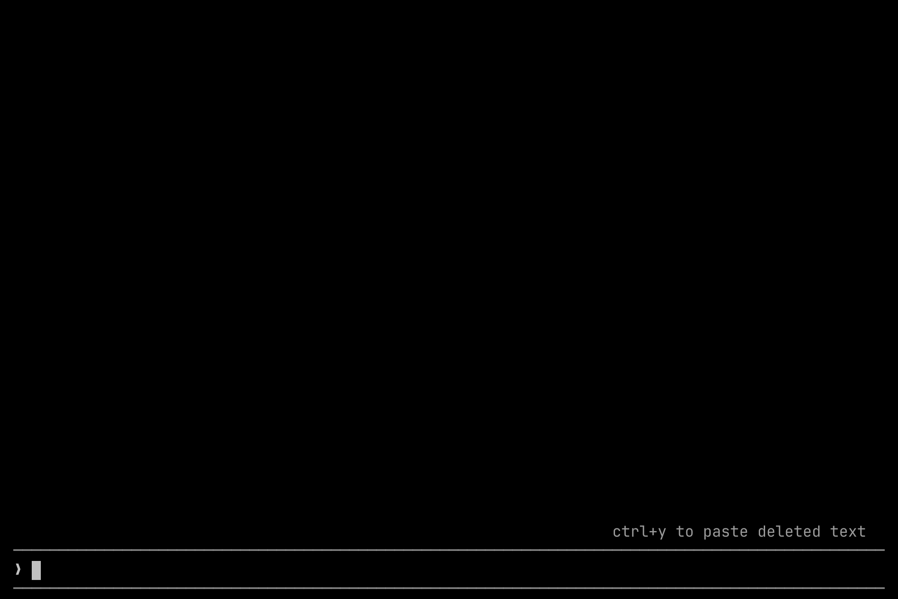

# cc-immerse

[English](README.md) | 日本語

**Claude Code で仕事をしながら、語学が身につく。**

画像は、母語が日本語、学習中の言語が英語の場合です。22 言語から好きな 2 つを設定できます。



自分の言葉で質問する。学んでいる言語で返信を読む。詰まったらクリックする。

## どちらの言語で打ってもいい



日本語で打つと、英語でどう言うかが出ます。英語で打つと、添削が出ます。切り替えは要りません。

## 自分のペースで進める

**レベル 1。** Claude とは日本語で話します。英語はクリックで開きます。



**レベル 2。** 同じく日本語で話し、英語が横に並びます。



**レベル 3。** Claude とは英語で話します。日本語が横に並びます。



**レベル 4。** 英語だけ。日本語はクリックで開きます。



## 意味は落ちない

翻訳は、言いたかったことを取りこぼすことがあります。だから、翻訳だけが Claude に届くことはありません。

| レベル | Claude に届くもの |
| --- | --- |
| 1、2 | あなたが打ったそのまま |
| 3、4 | 英語にしたものがメッセージとして届き、あなたが打った言葉が横に添えられる |

```
What is the build status?            ← メッセージ(英語)
<original-message language="Japanese">
ビルドの状態は？                       ← あなたが打った言葉。そのまま添えられる
</original-message>
```

2 つが食い違うとき、Claude はあなたの言葉のほうに従います。わざと間違えた英訳を添えて試したところ、3 回中 3 回、元の言葉に従いました。英語で打ったものは打ったまま送られます。添削はあなたにだけ見え、Claude には届きません。

## 設定は 1 画面



`/immerse` と打ちます。矢印で移動し、Enter で変更します。プレビューが、選んだ設定でどう見えるかを示します。22 言語から選べます。

## インストール

Claude Code のターミナルで:

```
/plugin install cc-immerse --marketplace kohey127/cc-immerse
```

シェルから:

```sh
claude plugin install cc-immerse --marketplace kohey127/cc-immerse
```

ターミナルで動く Claude Code が必要です。何も設定しなければ、母語は日本語、学習中の言語は英語です。どちらも `/immerse` で変えられます。

---

<details>
<summary>コマンド</summary>

| コマンド | 動作 |
| --- | --- |
| `/immerse` | 入力欄の上に設定を表示する |
| `/immerse off` | レベルを Off にし、入力中の補助も切る |
| `/immerse on` | 切る前の設定に戻す |
| `/immerse open` | 直近の返信の全ブロックで訳を開く |
| `/immerse close` | 開いている訳をすべて閉じる |

</details>

<details>
<summary>費用と制限</summary>

**費用**

翻訳と添削は、あなたの Claude Code アカウントで Claude Haiku を使います。

- レベル 1 と 4 では、返信が先に読む言語で書かれているかぎり、ブロックを開くまで費用はかかりません。レベル 2 と 3、および返信がもう一方の言語のときは、ブロックごとに小さな呼び出しが 1 回かかります。
- 入力中の補助がオンのときは、打つ手を止めるたびに小さな呼び出しが 1 回かかります。

**制限**

- **ターミナル専用です。** スマートフォンとデスクトップのアプリでは、試したかぎり何も表示されませんでした。理由はまだ分かっていません。
- **同じ文字を使う言語の組み合わせでは、返信の言語を文字で見分けられません。** その場合、返信は「そのレベルで Claude と話している言語」で書かれているものとして扱います。
- **同じ文字を使う言語の組み合わせでは、待ちが 1 回増えます。** 日本語と英語は文字ですぐに見分けられます。スペイン語と英語は見分けられないので、送信前に小さなモデルへ、どちらの言語かを尋ねます。
- **第三の言語で書いたメッセージには何もしません。** 打ったまま送られ、翻訳も添削も出ません。
- **レベル 3 と 4 では、メッセージに添えて「学んでいる言語で答えて」と Claude に伝えます。** これが無いと、Claude は添えられた元の言葉の言語で答えます。プラグインが Claude に何かを伝えるのはこの 1 か所だけです。
- **ポインタを乗せる・クリックする操作には、マウスに対応したターミナルが必要です。** 対応していない場合は `/immerse open` を使います。
- **段落はプラグインが描きます。** Claude Code の描画ではないので、太字・斜体・インラインコードの見た目が少し違うことがあり、段落内のリンクはクリックできません。
- Claude Code のインターフェース拡張用プラグイン API の上に作られています。この API は早期アクセスで、リリースごとに変わる可能性があります。

</details>

<details>
<summary>現状</summary>

初期段階です。日本語と英語の組み合わせで毎日使われています。ほかの言語はテストで確認していますが、日常での使用はまだです。上の画像は、決められた返信を使って、実際の Claude Code の画面から録画したものです(`screen/record.ts`)。

</details>

<details>
<summary>開発と先行プラグイン</summary>

プラグイン本体は `plugin/` にあります。構成、チェック、作業の進め方は `CLAUDE.md` に書いてあります。

```sh
claude plugin validate plugin
claude plugin test plugin
cd screen && bun install && bun test   # 実画面でのチェック
```

[cc-trans](https://github.com/ktk1012/cc-trans) と [Lingo](https://github.com/royisme/lingo) は Claude Code の会話を翻訳するプラグインで、これらを試したことがこのプラグインのきっかけです。どちらも、英語の横に自分の言語を並べます。cc-immerse は英語を前に出し、自分の言語は求めたときだけ見せます。まず英語を読むためです。入力中のプレビューは cc-trans のやり方にならっています。

</details>

MIT
