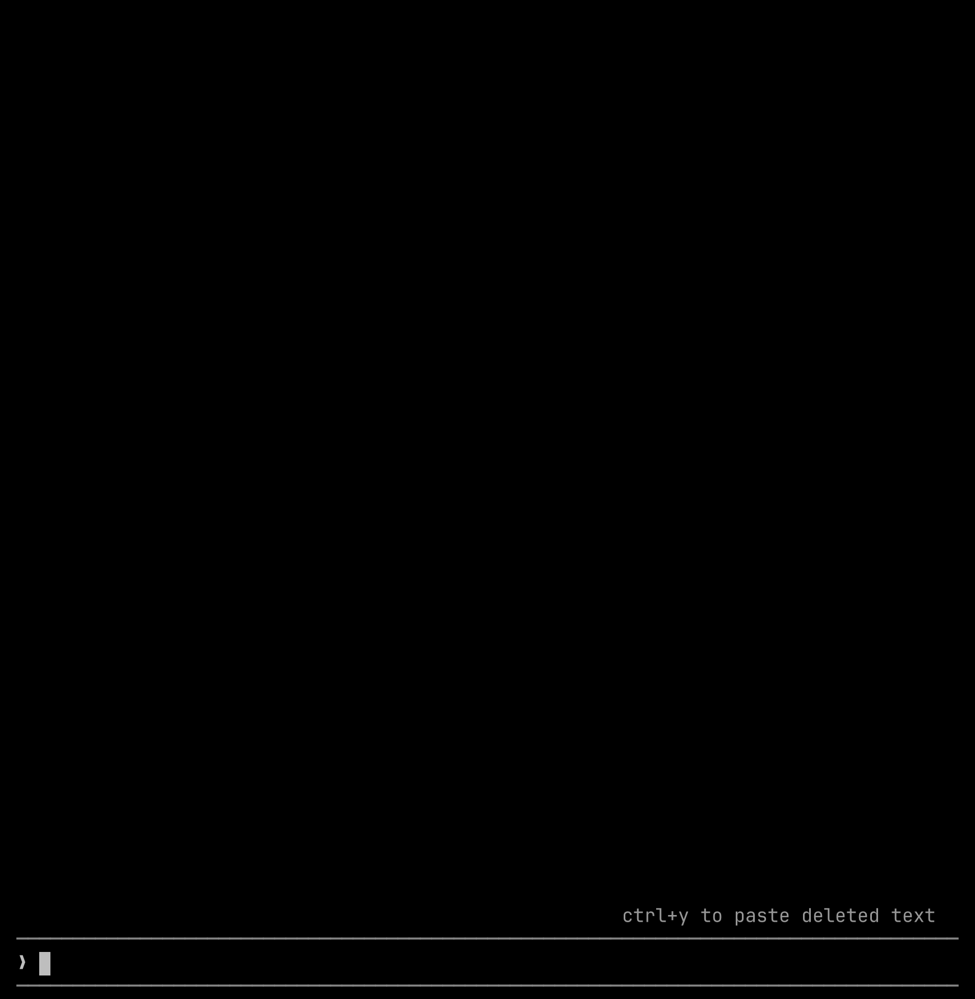
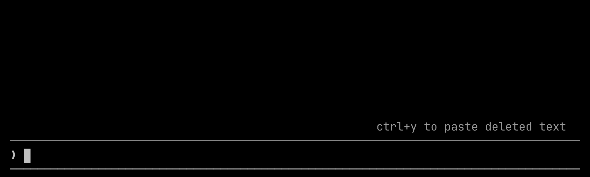
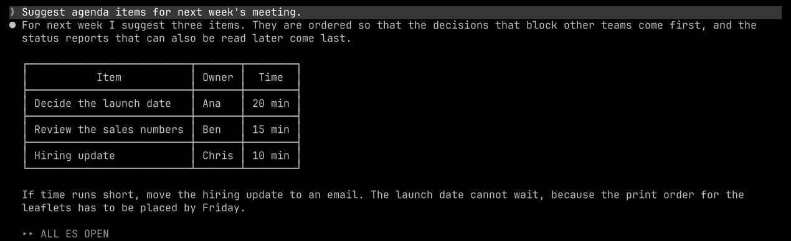
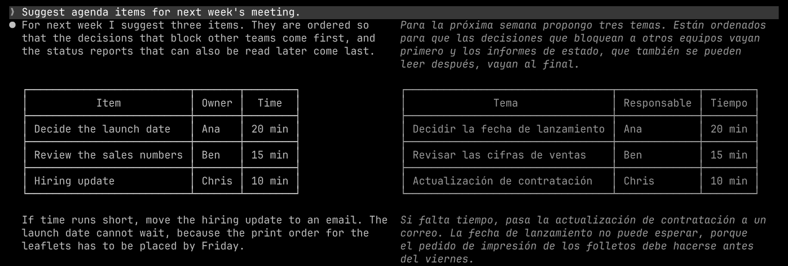
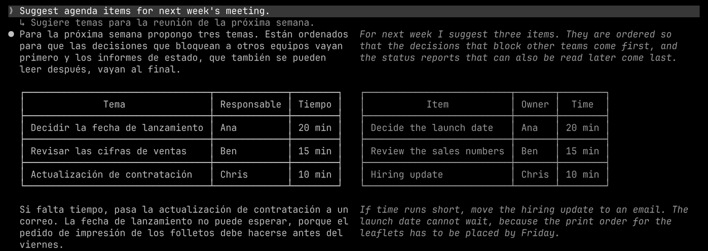
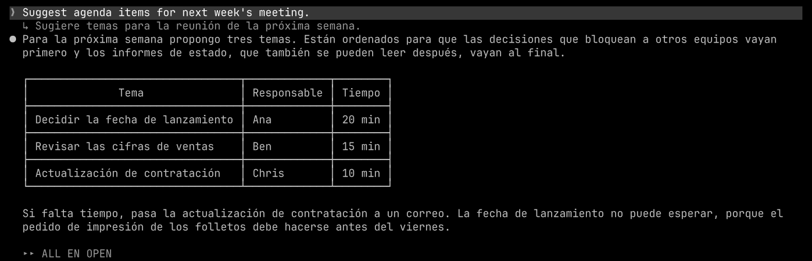
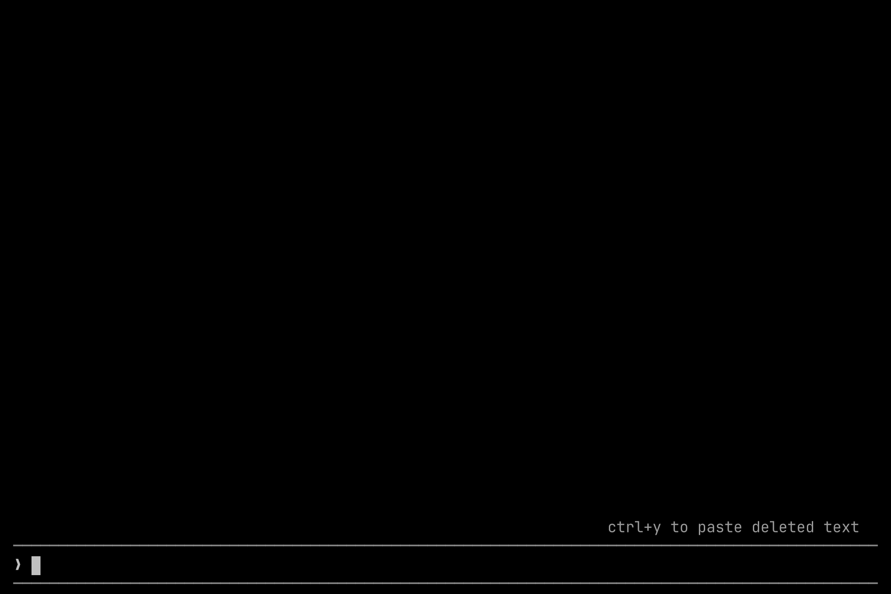

# cc-immerse

English | [日本語](README.ja.md)

**Learn a language while you work with Claude Code.**

The pictures show an English speaker learning Spanish. Any two of 22 languages can be set.



Ask in your language. Read the answer in the one you are learning. Click when you are stuck.

## Type in either language



Type in your language and see it in Spanish. Type in Spanish and see it corrected. Nothing to switch.

## Go at your own pace

**Level 1.** You and Claude talk in your language. Spanish is one click away.



**Level 2.** The same, with the Spanish beside it.



**Level 3.** You and Claude talk in Spanish. Your language is beside it.



**Level 4.** Spanish. Your language is one click away.



## Nothing you mean is lost

A translation can miss what you meant. So Claude never gets a translation alone.

| Level | What Claude gets |
| --- | --- |
| 1, 2 | Exactly what you typed |
| 3, 4 | The Spanish version as your message, with your own words beside it |

```
¿Cuál es el estado de la compilación?   ← your message, in Spanish
<original-message language="English">
What is the build status?               ← what you typed, kept beside it
</original-message>
```

Where the two differ, Claude goes by your own words: with a translation made wrong on purpose, it followed the original in 3 of 3 tries (measured with Japanese and English). What you type in Spanish is sent as typed; the correction is shown to you, not to Claude.

## One screen of settings



Type `/immerse`. Arrows move, Enter changes, and the preview shows what you will get. 22 languages.

## Install

In a Claude Code terminal session:

```
/plugin install cc-immerse --marketplace kohey127/cc-immerse
```

From a shell:

```sh
claude plugin install cc-immerse --marketplace kohey127/cc-immerse
```

Claude Code in a terminal is needed. Then type `/immerse` and pick your two languages: with nothing set, your language is Japanese and the one you are learning is English.

---

<details>
<summary>Commands</summary>

| Command | What it does |
| --- | --- |
| `/immerse` | Shows the settings above the prompt |
| `/immerse off` | Sets the level to Off and help while typing off |
| `/immerse on` | Brings back what was set |
| `/immerse open` | Opens the translation for every block of the latest reply |
| `/immerse close` | Closes every open translation |

</details>

<details>
<summary>Cost and limits</summary>

**What it costs**

Translations and corrections run on Claude Haiku through your own Claude Code account.

- At levels 1 and 4 a reply costs nothing until you open a block, when it is in the language you read first. At levels 2 and 3, and for a reply in the other language, each block is one small call.
- With help while typing on, a draft costs one small call each time you pause.

**Limits**

- **Terminal only.** In tests, the phone and desktop apps showed nothing. The reason is not known yet.
- **In a pair that shares an alphabet, a reply's language cannot be told by its letters.** It is taken to be in the language you and Claude talk in at your level.
- **Pairs that share an alphabet cost one more wait.** Japanese and English are told apart by their letters, at once. Spanish and English are not, so the small model is asked which language a message is in before it is sent.
- **A message in a third language is left alone**: sent as typed, with no translation and no correction.
- **At levels 3 and 4 Claude is told, beside your message, to answer in the language you are learning.** Without that it answers in the language of your own words, which it can see. This is the one place the plugin says anything to Claude.
- **Pointing and clicking need a terminal that reports the mouse.** Without it, use `/immerse open`.
- **Paragraphs are drawn by the plugin**, not by Claude Code, so bold, italics and inline code may look slightly different, and links inside them cannot be clicked.
- Built on Claude Code's plugin API for interface mods, which is early access and may change between releases.

</details>

<details>
<summary>Status</summary>

Early. It has been used daily for Japanese and English. The other languages, Spanish included, are covered by tests, not yet by daily use. The pictures above are recorded from a real Claude Code screen with scripted replies (`screen/record.ts`).

</details>

<details>
<summary>Development and prior work</summary>

The plugin is in `plugin/`. `CLAUDE.md` describes the layout, the checks and how the work is done.

```sh
claude plugin validate plugin
claude plugin test plugin
cd screen && bun install && bun test   # checks on a real screen
```

[cc-trans](https://github.com/ktk1012/cc-trans) and [Lingo](https://github.com/royisme/lingo) translate Claude Code conversations, and trying them led to this plugin. They show your own language next to the English. cc-immerse keeps the English in front and shows your language only when you ask, so that you read the English first. The live preview while you type follows the approach cc-trans takes.

</details>

MIT
