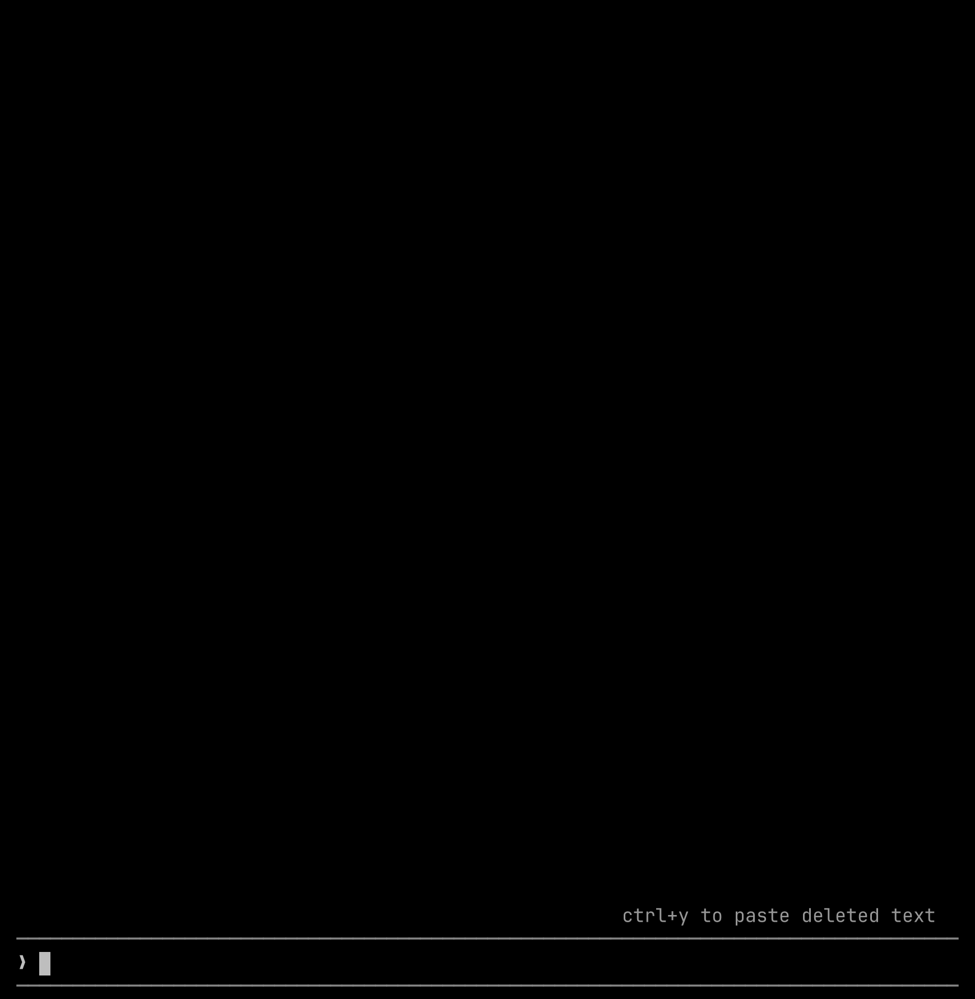
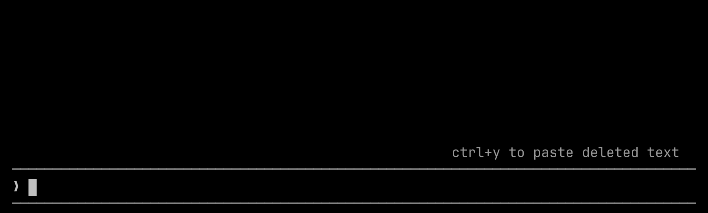
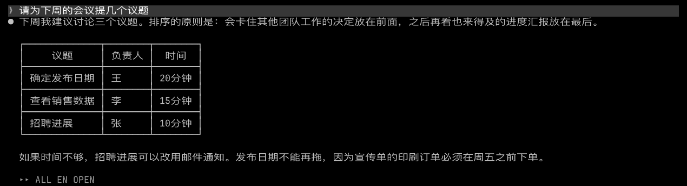
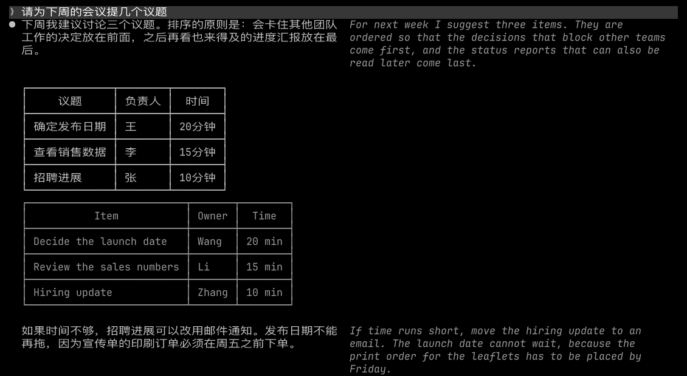
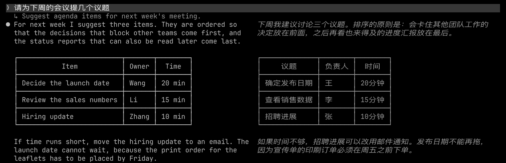
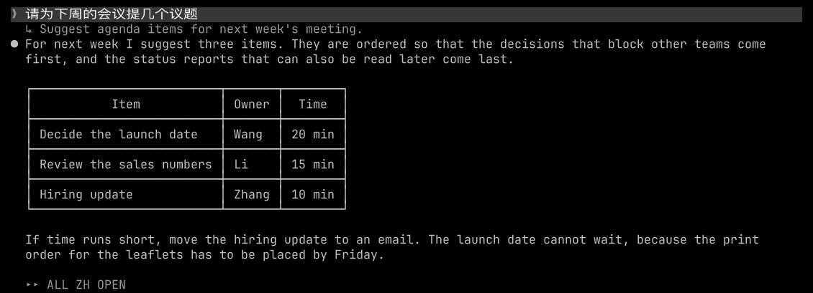
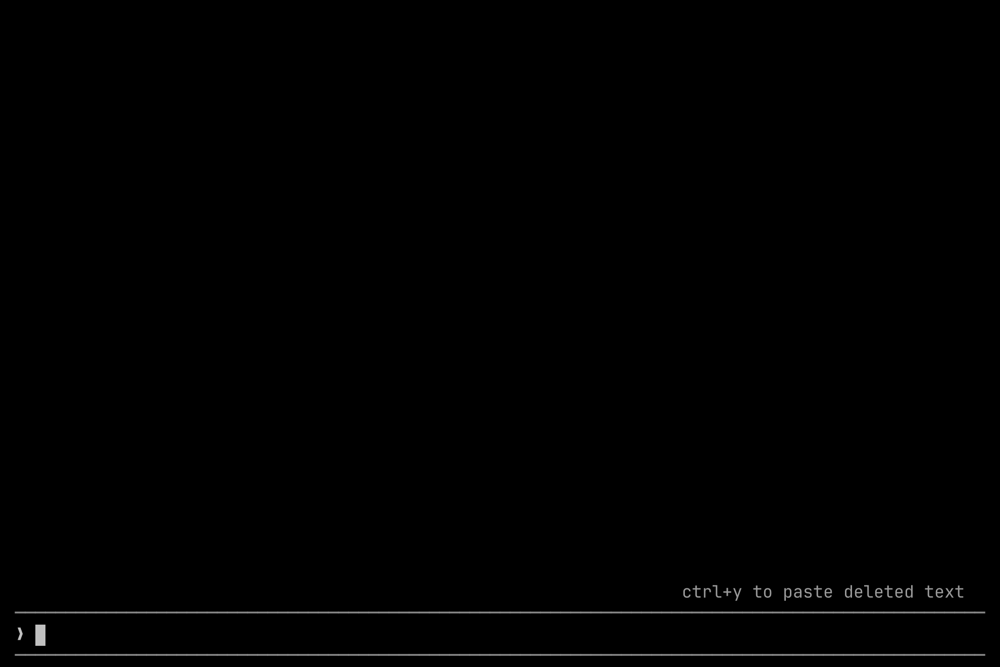

# cc-immerse

[](https://github.com/kohey127/cc-immerse/releases/latest)
[](LICENSE)
[](https://mods.aidojo.si/mods/kohey127--cc-immerse--cc-immerse/)

[English](README.md) | [日本語](README.ja.md) | 简体中文

**一边用 Claude Code 工作，一边学语言。**

图片展示的是母语为中文、正在学英语的情况。22 种语言中任选两种都可以。



用自己的语言提问。用正在学的语言读回复。卡住了就点一下。

## 用哪种语言输入都行



输入中文，会显示用英语怎么说。输入英语，会显示修改建议。不需要切换。

## 按自己的节奏来

**等级 1。** 你和 Claude 用中文交流。点一下就能看英语。



**等级 2。** 同样用中文交流，英语显示在旁边。



**等级 3。** 你和 Claude 用英语交流。中文显示在旁边。



**等级 4。** 只有英语。点一下就能看中文。



## 意思不会丢

翻译有时会漏掉你想表达的意思。所以，Claude 收到的永远不会只有翻译。

| 等级 | Claude 收到的内容 |
| --- | --- |
| 1、2 | 你输入的原文 |
| 3、4 | 英语版本作为消息，你输入的原文附在旁边 |

```
What is the build status?            ← 消息（英语）
<original-message language="Chinese (Simplified)">
构建状态如何？                         ← 你输入的原文，原样附上
</original-message>
```

两者不一致时，Claude 以你的原文为准：我们故意附上一条错误的译文做过测试，3 次中有 3 次它都按原文回答（测试用的是日语和英语）。用英语输入的内容会原样发送；修改建议只显示给你，不会发给 Claude。

## 设置只有一屏



输入 `/immerse`。方向键移动，Enter 修改，预览会显示所选设置的效果。共 22 种语言。

## 安装

在 Claude Code 的终端会话中：

```
/plugin install cc-immerse --marketplace kohey127/cc-immerse
```

在 shell 中：

```sh
claude plugin install cc-immerse --marketplace kohey127/cc-immerse
```

需要在终端中运行的 Claude Code。安装后输入 `/immerse`，选择你的两种语言：不做任何设置时，母语是日语，学习的语言是英语。

## 更新

请先开启一次自动更新：在 `/plugin` 的 Marketplaces 中，为 `cc-immerse` 打开 auto-update。之后新版本会在 Claude Code 启动时自动安装。

手动更新：

```sh
claude plugin marketplace update cc-immerse
claude plugin update cc-immerse
```

更新后请重启 Claude Code。

---

<details>
<summary>命令</summary>

| 命令 | 作用 |
| --- | --- |
| `/immerse` | 在输入框上方显示设置 |
| `/immerse off` | 把等级设为 Off，并关闭输入时的辅助 |
| `/immerse on` | 恢复关闭前的设置 |
| `/immerse open` | 展开最新回复中每个段落的译文 |
| `/immerse close` | 收起所有已展开的译文 |

</details>

<details>
<summary>费用与限制</summary>

**费用**

翻译和修改通过你自己的 Claude Code 账户使用 Claude Haiku。

- 在等级 1 和 4，只要回复是用你先读的那种语言写的，展开段落之前不产生费用。在等级 2 和 3，以及回复是另一种语言时，每个段落需要一次小调用。
- 开启输入时的辅助后，每次停顿会对草稿进行一次小调用。

**限制**

- **仅限终端。** 在测试中，手机和桌面应用没有显示任何内容，原因尚不清楚。
- **两种语言使用相同字母时，无法通过字母判断回复的语言。** 这时会把回复当作你在该等级下与 Claude 交流所用的语言。
- **两种语言使用相同字母时，会多等待一次。** 中文和英语可以通过文字立刻区分。西班牙语和英语不行，所以发送前会先问小模型这条消息是哪种语言。
- **用第三种语言写的消息不做处理**：原样发送，不翻译也不修改。
- **在等级 3 和 4，会随消息告诉 Claude 用你正在学的语言回答。** 否则它会用附在旁边的原文的语言回答。这是插件唯一会对 Claude 说话的地方。
- **悬停和点击需要支持鼠标的终端。** 不支持时请使用 `/immerse open`。
- **段落由插件绘制**，而不是 Claude Code，所以粗体、斜体和行内代码的样子可能略有不同，段落中的链接也无法点击。
- 基于 Claude Code 用于界面扩展的插件 API，该 API 处于早期访问阶段，可能随版本变化。

</details>

<details>
<summary>现状</summary>

早期阶段。日语和英语的组合每天都在使用。其他语言（包括中文）有测试覆盖，但还没有经过日常使用。上面的图片是用预设的回复，从真实的 Claude Code 屏幕录制的（`screen/record.ts`）。本页的中文尚未经母语者校对，欢迎指正。

已收录于社区的 Claude Code mod 目录，该目录会扫描 mod 能访问什么以及是否通过校验：

[](https://mods.aidojo.si/mods/kohey127--cc-immerse--cc-immerse/)

</details>

<details>
<summary>开发与相关项目</summary>

插件位于 `plugin/`。目录结构、检查方式和工作方法见 `CLAUDE.md`。

```sh
claude plugin validate plugin
claude plugin test plugin
cd screen && bun install && bun test   # 在真实屏幕上的检查
```

[cc-trans](https://github.com/ktk1012/cc-trans) 和 [Lingo](https://github.com/royisme/lingo) 是翻译 Claude Code 对话的插件，试用它们之后才有了这个插件。它们把你的母语显示在英语旁边。cc-immerse 把英语放在前面，只有在你需要时才显示母语，这样你会先读英语。输入时的实时预览沿用了 cc-trans 的做法。

</details>

如果对你有用，点个 Star 能帮助更多人发现它。

MIT
